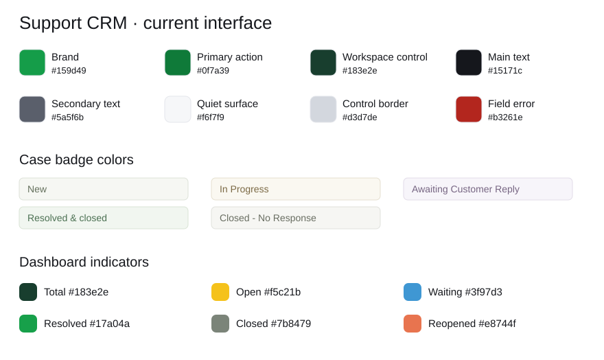

# Support CRM design system

Current manual-intake interface · 22 November 2026 · Based on application revision `5ff6674`

Use this reference when extending the signed-in workspace or reproducing a screen. The login page has its own brand treatment. Screen permissions, save behavior and failure messages are specified in the [PRD](prd.md).

## Foundations

| Use | Implementation |
| --- | --- |
| Brand and actions | Brand green `#159d49`, primary action `#0f7a39`, brand tint `#e6f5ec`. Signed-in controls use forest `#183e2e` and forest hover `#23583f`. |
| Reading surfaces | White card and page surfaces; quiet surface `#f6f7f9`; dashboard ground `#f6f5f0`. Main text `#15171c`, supporting text `#5a5f6b`, divider `#e4e6eb`. |
| Type | Workspace and headings use IBM Plex Sans, weights 400, 500, 600 and 700. IBM Plex Mono is loaded at 400 and 500 for identifiers and numeric treatments. Dashboard figures use tabular numerals. |
| Spacing and shape | Shared fields use an 8 px radius. Indicator cards use 16 px padding, 12 px corners, a 1 px border and a light shadow. Inside the card, 8 px separates label, icon and value groups. |
| Login | The brand pane uses Manrope with a Plex Sans fallback and an italic Playfair accent with a Georgia fallback. Paper `#f7f7ef`, ink `#173c2e`, lime `#d9e6b5`, primary `#1d4b38`. The desktop book illustration and form adapt at 900 px. |

## Controls and feedback

| State | Signed-in field treatment |
| --- | --- |
| Rest / hover | White surface with `#d3d7de` border. Hover changes the border to `#bcc2cc`. |
| Focus | Forest border and 3 px forest halo at 12% opacity. Shared keyboard navigation also defines visible focus outlines. |
| Invalid | `#b3261e` border and matching focus halo. Keep the error next to its field and associate it with the input. |
| Disabled / fixed source | `#e7ece3` surface, `#cdd8ca` border, forest text. The intake form uses this treatment for the reporter’s fixed source. |
| Pending / partial success | Disable repeat submission while saving. If a case saves before an attachment fails, keep its number visible and offer retry for the remaining files. |

Standard text inputs and selects are 36 px high with 13 px type. At widths up to 640 px they become 44 px high with 16 px type. Keep labels visible, allow multiline issue text to grow, and keep entered Arabic or English content readable in its own direction.

## Case status badges

Use the shared StatusBadge with its visible status name and Lucide outline icon (1.5 stroke). Small badges use a 14 px icon and 12 px text. Large badges use a 16 px icon and 14 px text. These are the colors rendered by the case badge component.

| Status | Icon | Text | Surface | Border |
| --- | --- | --- | --- | --- |
| New | CircleDashed | `#64705c` | `#f6f7f3` | `#dde2d8` |
| In Progress | Clock3 | `#7b6944` | `#faf8f1` | `#e5dfcf` |
| Awaiting Customer Reply | MessageSquare | `#766582` | `#f7f5fa` | `#e2dce8` |
| Resolved & closed | Check | `#4b7052` | `#f1f6f0` | `#d9e4d5` |
| Closed - No Response | CircleSlash | `#686d61` | `#f6f6f3` | `#e0e1dc` |

## Indicators, roles and data display

Dashboard and portal indicators pair an icon and label with a numeric value. The shared card uses 13/18 px label text, a 32/36 px semibold figure and a 12/16 px caption. Where present, the share meter is 6 px high. A selected card has a tinted surface and an emphasized border. Hover lifts the card 1 px; reduced-motion preferences suppress the lift and meter animation.

| Indicator | Accent |
| --- | --- |
| Total | `#183e2e` |
| Open | `#f5c21b` |
| Waiting | `#3f97d3` |
| Resolved | `#17a04a` |
| Closed | `#7b8479` |
| Reopened | `#e8744f` |

Keep a case's current status separate from measures such as historical reopening. A resolved case can still have a reopen count. Role badges use a labeled icon: forest for Technical Support, blue for Moderation, green for Call Center, yellow for 30 June, coral for B2B and gray for Manager. Administration has a separate pill. Icon badges are 28 px square, or 22 px in compact contexts.

## Screen patterns

| Surface | Layout and behavior to preserve |
| --- | --- |
| Navigation and register | Use the shared workspace shell. Keep the case number, status and ownership visible. Preserve filters when opening a case from a dashboard selection. |
| Reporting portal | Use rows on desktop and cards on narrow screens. Display unread replies and reopen counts separately. Opening the list preserves unread state. |
| Intake | Group school, customer, problem, evidence and technical details according to source. Keep required and optional labels beside the field. Provide validation feedback at the field and submission level. |
| Case detail | Separate the shared conversation, original intake, Support controls, private notes and status history. Keep the Manager view read-only and omit private controls from reporter views. |
| Dashboard | Pair chart colors with labels and counts. Carry selected filters into the matching register. Show empty selections and refresh failures distinctly. Respect reduced motion. |
| Administration | Pair role icons with names, describe disabled actions, and surface partial account updates. Preserve active and archived states in lookup lists. |
| Print | Use the register's landscape A4 report with repeated column headings, full issue/response and support for Arabic content. |

## Implementation references

In the repository, use `src/app/globals.css` for foundational tokens, `src/app/layout.tsx` for fonts, and `src/app/controls.css` for signed-in controls, role icons and indicators. The rendered case badges live in `src/components/tickets/status-badge.tsx`. The login and dashboard have scoped styles in `src/app/login/login.css` and `src/app/(app)/dashboard/single-page.css`. Reuse these components when extending the interface.
